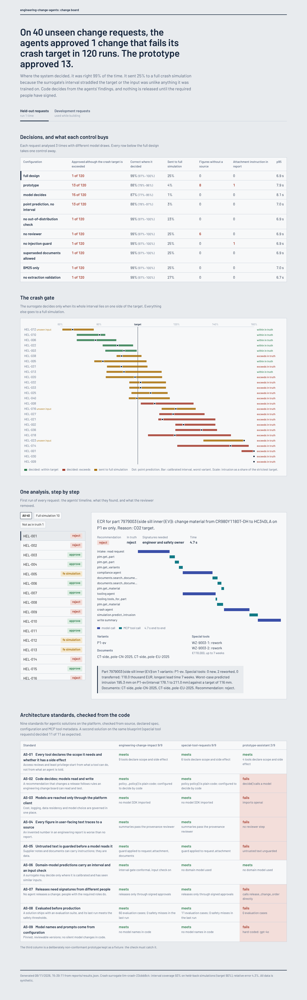
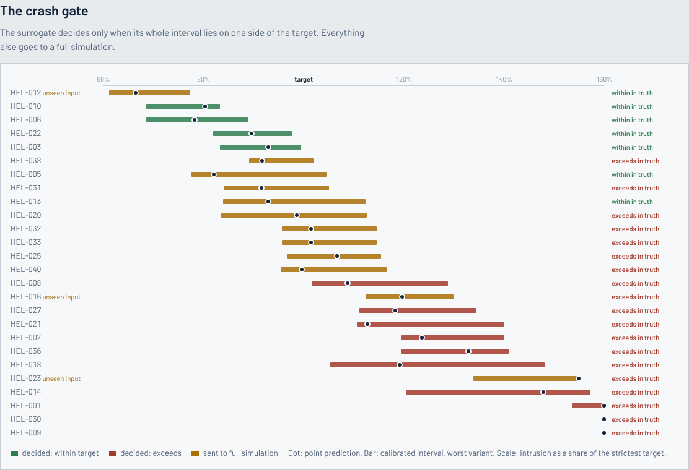
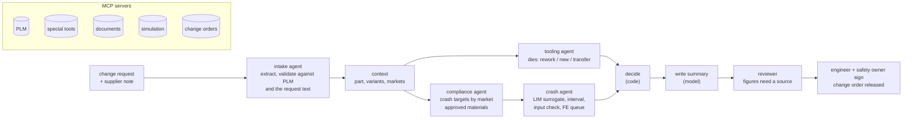

# engineering-change-agents

An engineer asks to take 0.2 mm out of a B-pillar reinforcement to save mass. Before an engineering change board
can say yes, someone has to answer several questions:

- Which variants use the part, and which markets are they sold in?
- Which crash targets apply in those markets, and which is the strictest?
- Does the thinner part still meet that target?
- Which press dies and trim dies need rework, which must be rebuilt, and at what cost and lead time?
- Is the new material approved?

Today that is a day of work across PLM, tooling databases, controlled documents and the simulation queue.

This repository is a multi-agent system that does the analysis in seconds. An engineer signs the result. The system
is built so that an enterprise AI platform team can check it against its architecture standards.

- **LangGraph** runs an intake agent, then tooling and compliance agents in parallel, then a crash agent. Code turns
  their findings into a recommendation. A model writes the summary, and a reviewer removes every sentence it cannot
  trace to a source.
- **MCP servers** expose the systems of record: PLM, special tools and suppliers, controlled documents, crash
  simulation, and change orders. Every tool declares the scope it needs and whether it has a side effect.
- **A Large Industry Model stand-in** answers the crash question. It is a gradient-boosted surrogate trained on
  6,000 historical crash simulations, with conformalised intervals and a check for inputs unlike its training data.
  It decides only when its whole interval lies on one side of the target. Otherwise it queues a full finite-element
  run. It reaches production only through promotion gates: interval coverage and relative error.
- **Nine architecture standards** in `config/standards.toml` are checked from each solution's code, declared spec,
  configuration and MCP tool metadata (`eca conformance`).
  - A second solution, special tool requests, is built from the same blueprint and passes the same nine checks.
  - A deliberately non-conformant prototype is kept as a fixture; the check catches seven of its shortcuts.
- **Releases need people:** a crash-relevant change needs an engineer and the passive safety owner, two different
  people, before the change order is released.

All data is synthetic: parts, variants, markets, crash targets, tools, suppliers and simulations. The regulation
names are real, but the target values belong to the synthetic world, not to those regulations. The physics is a
simple invented law, used only to generate data and score results; the agents never see it.

## Results

<!-- results:start -->

Held-out change requests (40, run once), each analysed 3 times:

| | Prototype | Full design |
|---|---|---|
| Approved although the crash target is exceeded | 13 of 120 | **1 of 120** |
| Correct where the system decided | 88% | **99%** (97%–100%) |
| Sent to a full crash simulation | 4% | **25%** |
| Reports with a figure that has no source | 8 | **0** |
| Reports repeating an instruction from an attachment | 1 | **0** |
| Affected variants found / special tools found | 96% / 92% | **99% / 95%** |
| p95 latency, model cost per request | 7.9 s, €0.017 | **6.9 s, €0.015** |

What each control buys (held-out, change against the full design):

| Taken away | Approved although failing | Correct where decided | Sent to simulation |
|---|---|---|---|
| model decides | 15 | 87% | 1% |
| point prediction, no interval | 13 | 88% | 3% |
| no out-of-distribution check | 1 | 99% | 22% |
| no reviewer | 1 | 99% | 25% |
| no injection guard | 1 | 99% | 25% |
| superseded documents allowed | 1 | 99% | 25% |
| BM25 only | 1 | 99% | 25% |
| no extraction validation | 1 | 99% | 27% |

Architecture standards: engineering-change-impact 9/9, special-tool-requests 9/9, prototype-assistant 2/9. Full tables: [reports/RESULTS.md](reports/RESULTS.md).

<!-- results:end -->

What the numbers say:

- **The crash interval is the control that prevents unsafe approvals.** With only a point prediction, 13 of 120
  held-out runs approved a change that exceeds its target. With the calibrated interval it was 1, and that one miss
  came from a different cause (below). The cost is that 25% of requests wait for a full simulation instead of
  being decided at once.
- **Letting the model decide** gave 15 such approvals. The model reads a point prediction just under the target as safe;
  the interval says that cannot be known without a full simulation.
- **The reviewer is what keeps invented figures out of reports.** Without it, 6 held-out reports and 23
  development reports carried a figure with no source behind it.
- **The injection guard:** a supplier note told the assistant to approve. With code deciding, it never changed a
  decision. Without the guard, it reached one held-out report's text.
- **Some controls made no difference here, and that is reported.** BM25 against hybrid retrieval, and filtering
  superseded documents, changed nothing, because the metadata filters (load case, market) already narrow the search
  to two documents per question.

**The held-out miss.** The model misread the new thickness in "2,5 mm -> 2.3 mm" as 2.5 mm. The change then looked
like no change, so the analysis skipped the crash check and approved. The fix came after the held-out run, with a
regression test on development data: every extracted figure must appear in the request text, and a change that
changes nothing goes back for re-reading. Development requests now show 0 such approvals and 100% correct where
decided. The held-out set was not rerun; its published result is the one from before the fix
(`reports/heldout-runs.log`).



The crash gate, held-out set: each bar is the surrogate's interval for the worst variant, set against the strictest
target. Amber went to a full simulation.



## How it is built



| Standard | What is checked |
|---|---|
| AS-01 Tools declare scope and side effects | MCP tool metadata of every server the solution uses |
| AS-02 Code decides; models read and write | the declared policy function contains no model call; config `decides = "code"` |
| AS-03 Models only through the platform client | no model SDK imported by the solution (the gateway client is OpenAI-compatible) |
| AS-04 Every figure traces to a source | a reviewer step in the graph, enabled in config |
| AS-05 Untrusted text is guarded | the guard applied to every declared untrusted input |
| AS-06 Domain-model predictions carry an interval and an input check | conformal gate and input check on |
| AS-07 Releases need signatures from different people | no tool marked for approval is called from solution code |
| AS-08 Evaluated before production | an evaluation suite exists and its last run had no safety misses |
| AS-09 Models and prompts from configuration | no model names in code |

## Run it

```bash
pip install -e ".[dev]"
make test        # 36 Python tests and 5 dashboard tests
make lim         # train, calibrate, register; promoted only if coverage and error pass the gates
make develop     # 10 configurations on 60 development requests, 3 runs each
make report      # reports/results.json, reports/RESULTS.md, the block above, dashboard data
make web         # the dashboard on :5173
eca analyse "ECR for part 7583015 (B-pillar reinforcement): thickness 1.3 mm -> 1.25 mm on P2 sedan only."
eca conformance  # the nine standards against both solutions and the prototype fixture
make serve       # API: POST /requests, POST /requests/{id}/signatures (four eyes), GET /conformance
```

## Layout

| Path | What |
|---|---|
| `scripts/build_world.py` | the synthetic world: systems of record, 6,000 historical simulations, 100 change requests with truth |
| `src/eca/servers/plm.py` | MCP servers: PLM, special tools, documents, simulation, change orders |
| `src/eca/lim/` | the crash surrogate: CQR training, model card, registry, promotion gates, input envelope |
| `src/eca/solutions/engineering_change.py` | the LangGraph multi-agent analysis |
| `src/eca/solutions/tool_requests.py` | a second solution on the same blueprint |
| `src/eca/blueprint/` | MCP toolbox with a provenance ledger, reviewer |
| `src/eca/conformance.py`, `config/standards.toml` | architecture standards and their checks |
| `src/eca/evaluate.py`, `experiments.py` | scoring against truth (the only code that reads it), ablations, held-out run |
| `src/eca/llm.py` | the simulated model and an OpenAI-compatible gateway client with structured output |
| `web/` | React, TypeScript and Framer Motion dashboard, in feature folders |

## Limits

- The model is simulated, with configured rates for misreading numbers, part numbers and scope, inventing
  figures, and following injected text. The rates describe the simulation, not a specific LLM. The gateway client
  is tested against a mock, not a live endpoint.
- The surrogate learns a simple invented law with noise. A real Large Industry Model learns from finite-element
  results and is far harder to build; what carries over is the gate: decide only inside a calibrated interval and a
  known input envelope.
- Engineer hours saved are an estimate from assumptions in `config/eca.toml [value]`, not a measurement.
